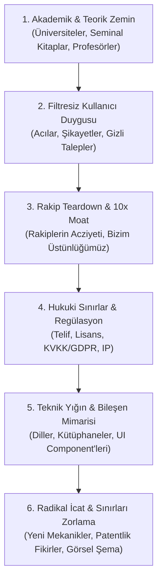

# ⚡ Frontier Innovator: Radical Product & Deep-Tech Innovation Engine

[](https://opensource.org/licenses/MIT)
[](https://github.com)
[](https://github.com)
[](https://python.org)

**Frontier Innovator**, yapay zeka ajanlarını yüzeysel cevaplar veren asistanlardan; bir konuyu **en uç akademik literatür**, **filtresiz pazar/kullanıcı acıları**, **acımasız rakip analizi**, **hukuki regülasyonlar** ve **sınırları zorlayan radikal icatlarla** sıfırdan kurgulayan bir **"Baş Mimara & İnovasyon Stratejistine"** dönüştüren özel bir Agent Skill'dir. Aynı zamanda sıfır harici paket gerektiren bağımsız bir CLI araştırma aracıdır.

---

## 🖥️ Hızlı Başlangıç: Tek Komutla Canlı Araştırma (CLI)

Bu repo sadece bir prompt/skill değil; herhangi bir konuyu arXiv, patent arşivleri ve geliştirici forumlarından tarayıp canlı araştırma dosyası ve **görsel HTML paneli** çıkaran bağımsız bir motordur:

```bash
# Markdown Dosyası + İnteraktif Mermaid & Dark Mode HTML Paneli Çıkarır:
python run_innovator.py "Autonomous Agents" --output dossier.md --html report.html
```

Bu komut:
1. **arXiv:** En güncel hakemli makaleleri ve profesörlerin tezlerini çeker.
2. **Topluluk:** Hacker News ve geliştirici forumlarındaki gerçek sürtünme ve şikayet noktalarını süzer.
3. **Patent:** Google Patents üzerinden ilgili kurumsal tescilleri tarar.
4. **Çıktı:** Hem analiz markdown dosyası (`dossier.md`) hem de tarayıcıda tek tıkla açılabilen **Mermaid diyagramlı karanlık mod görsel dashboard (`report.html`)** üretir!

---

## 🎯 Temel Amaç ve Çözdüğü Problem

Yapay zekalar genelde kendilerine bir ürün veya sistem sorulduğunda sıradan, internetteki klişeleri tekrarlayan ve vasat çözümler önerir. 

**Frontier Innovator bu vasatlığı reddeder:**
* 🏛️ **Akademik Bilgiyi Sömürür:** MIT, Stanford, Oxford seviyesindeki temel teorileri, çığır açan makaleleri ve efsane profesörlerin (Knuth, LeCun, Christensen) zihinsel modellerini çeker.
* 💬 **Filtresiz Kullanıcı Gerçeğini Yakalar:** Cilalı anketleri değil; Reddit, forumlar ve uygulama mağazalarındaki 1 yıldızlı şikayetleri ve gizli arzuları inceler.
* ⚔️ **Rakipleri Teardown Eder:** Rakiplerin kör noktalarını ve yapısal hantallıklarını bulup 10 kat daha üstün ("10x Moat") bir strateji çizer.
* ⚖️ **Hukuki Zırh Örer:** Fikri mülkiyet (IP), patentler, KVKK/GDPR ve regülasyonları baştan hesaba katar.
* 🛠️ **Teknik & UI Bileşen Mimarisini Kurar:** En doğru dilleri, performans parametrelerini ve modern component kütüphanelerini seçer.
* 🚀 **Radikal İcatlar Üretir (Zorunlu):** Daha önce kimsenin birleştirmediği mekanikleri birleştirir, sisteme entegre eder ve **Mermaid mimari şemalarıyla** modeller.

---

## 🏗️ 6 Fazlı İcra Protokolü



Detaylı rehber ve düşünce modelleri için [heuristic-frameworks.md](./references/heuristic-frameworks.md) dokümanını inceleyin.

---

## 📁 Proje Yapısı

```text
frontier-innovator/
├── SKILL.md                          # Ajanın okuduğu ana skill tanımı ve icra protokolü
├── README.md                         # Dokümantasyon ve kurulum kılavuzu
├── LICENSE                           # Açık kaynak lisansı (MIT)
├── scripts/                          # Sıfır-bağımlılık yerleşik CLI araştırma araçları
│   ├── fetch_academic_papers.py      # arXiv API üzerinden canlı akademik makale çekici
│   ├── mine_user_sentiment.py        # Hacker News & topluluklardan şikayet/acı madencisi
│   ├── search_prior_art.py           # Google Patents üzerinden patent & prior art arayıcı
│   └── export_html_report.py         # Markdown raporları karanlık mod HTML dashboard'a çevirici
├── references/
│   ├── heuristic-frameworks.md       # Zihinsel modeller, First Principles, akademik matris
│   └── triz-invention-engine.md      # TRIZ sistematik icat motoru & çelişki çözme matrisi
└── examples/
    └── sample-innovator-report.md    # Örnek uç nokta analiz ve mimari çıktısı
```

---

## 🛠️ Yerleşik Araştırma Betikleri (Built-in Helper Scripts)

Bu skill sadece bir talimatname değildir; ajanın veya kullanıcının doğrudan çalıştırabileceği sıfır-harici-kütüphane Python araçlarına sahiptir:

* **Akademik Makale Taraması:**
  ```bash
  python scripts/fetch_academic_papers.py "zero-knowledge proofs" --max 3
  ```
* **Kullanıcı Şikayet & Acı Madenciliği:**
  ```bash
  python scripts/mine_user_sentiment.py "Kubernetes" --max 3
  ```

---

## 🚀 Kurulum (Installation)

### Seçenek 1: Antigravity Projenize Eklemek (Önerilen)
Projenizin kök dizininde `.agents/skills/` altına bu repoyu klonlayın:

```bash
mkdir -p .agents/skills
git clone https://github.com/KULLANICI_ADINIZ/frontier-innovator.git .agents/skills/frontier-innovator
```

### Seçenek 2: Global Olarak Tüm Projelerinizde Kullanmak
Tüm bilgisayarınızdaki Antigravity oturumlarında geçerli olması için:

```bash
# Windows (PowerShell)
git clone https://github.com/KULLANICI_ADINIZ/frontier-innovator.git "$env:USERPROFILE\.gemini\config\skills\frontier-innovator"

# macOS / Linux
git clone https://github.com/KULLANICI_ADINIZ/frontier-innovator.git ~/.gemini/config/skills/frontier-innovator
```

### Seçenek 3: Claude Desktop, Cursor veya Diğer Ajanlar
`SKILL.md` dosyasının içeriğini kopyalayarak ajanın sistem istemine (System Prompt), proje kuralına (`.cursorrules` vb.) veya özel talimatlarına ekleyebilirsiniz.

---

## 💡 Nasıl Tetiklenir? (Örnek İstekler)

Skill kurulduktan sonra ajana aşağıdaki gibi hedefler verdiğinizde otomatik olarak 6 fazlı protokolü başlatacaktır:

> *"Yeni nesil otonom bir kod analiz platformu yapmak istiyorum. Frontier Innovator protokolünü çalıştırarak akademik temellerinden radikal icatlarına kadar baştan sona planla."*

> *"Canlı video streaming pazarında rakiplerin hantallıklarını ezecek, kullanıcı şikayetlerini kökten çözecek bir sistem tasarlayalım. Sınırları zorla."*

Gerçek bir çıktı görmek için [Örnek Raporu](./examples/sample-innovator-report.md) inceleyebilirsiniz.

---

## 📄 Lisans
Bu proje [MIT Lisansı](./LICENSE) kapsamında açık kaynak olarak sunulmuştur.
