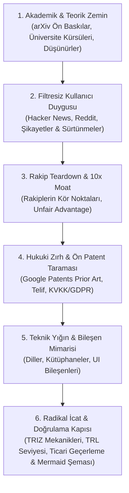

# ⚡ Frontier Innovator: Radical Product & Deep-Tech Innovation Engine

[](https://opensource.org/licenses/MIT)
[](https://github.com/omerefezobar-jpg/zobar-skill/actions)
[](https://github.com/omerefezobar-jpg/zobar-skill)
[](https://python.org)
[](https://github.com/omerefezobar-jpg/zobar-skill)

**Frontier Innovator**, yapay zeka ajanlarını yüzeysel cevaplar veren asistanlardan; bir konuyu **akademik ön baskı literatürü**, **filtresiz pazar/kullanıcı sürtünmeleri (Hacker News + Reddit)**, **acımasız rakip analizi**, **ön patent araştırması** ve **fizibilitesi kanıtlanmış radikal icatlarla** sıfırdan kurgulayan bir **"Baş Mimara & İnovasyon Stratejistine"** dönüştüren üretim kalitesinde bir Agent Skill ve bağımsız araştırma motorudur.

---

## 🎯 Temel Amaç ve Çözdüğü Problem

Yapay zekalar genelde kendilerine bir ürün veya sistem sorulduğunda sıradan, internetteki klişeleri tekrarlayan ve vasat çözümler önerir. 

**Frontier Innovator bu vasatlığı reddeder:**
* 🏛️ **Akademik Bilgiyi Sömürür:** MIT, Stanford, Oxford düzeyindeki temel teorileri, ArXiv pre-print makalelerini ve efsane profesörlerin/düşünürlerin (Knuth, LeCun, Christensen, Lamport) zihinsel modellerini çeker.
* 💬 **Çok Kaynaklı Kullanıcı Gerçeğini Yakalar:** Cilalı anketleri değil; Hacker News ve Reddit topluluklarındaki sürtünme noktalarını, 1 yıldızlı şikayetleri ve gizli arzuları madencilikle süzer.
* ⚔️ **Rakipleri Teardown Eder:** Rakiplerin kör noktalarını ve yapısal hantallıklarını bulup 10 kat daha üstün ("10x Moat") bir strateji çizer.
* ⚖️ **Ön Patent & Fikri Mülkiyet Zırhı:** Google Patents üzerinden öncelikli teknik (prior art) taraması yapar; patent ihlali risklerini ve faaliyet serbestisi sınırlarını baştan hesaba katar.
* 🛠️ **Teknik & UI Bileşen Mimarisini Kurar:** En doğru dilleri, performans parametrelerini ve modern component kütüphanelerini seçer.
* 🚀 **Fizibilitesi Kanıtlanmış Radikal İcatlar (Zorunlu):** TRIZ çelişki prensiplerini kullanarak icat üretir. Üretilen her icat için **TRL (Teknolojik Olgunluk Seviyesi), ICE Skoru, WTP (Ödeme İstekliliği) ve Kritik Hata Modları** zorunlu olarak belgelenir.
* 📊 **Mermaid & Güvenlikli HTML:** Analizleri interaktif Mermaid mimari şemaları ve XSS korumalı karanlık mod HTML dashboard ile sunar.

---

## 🖥️ Hızlı Başlangıç: Tek Komutla Canlı Araştırma (CLI)

Bu repo sadece bir prompt/skill değil; herhangi bir konuyu arXiv, Google Patents ve topluluk forumlarından tarayıp canlı araştırma dosyası ve **güvenlik zırhlı görsel HTML paneli** çıkaran bağımsız bir motordur:

```bash
# Markdown Dosyası + İnteraktif Mermaid & Dark Mode HTML Paneli Çıkarır:
python run_innovator.py "Autonomous Agents" --output dossier.md --html report.html
```

---

## 🏗️ 6 Fazlı İcra Protokolü



Detaylı rehber ve düşünce modelleri için:
- [heuristic-frameworks.md](./references/heuristic-frameworks.md) — First Principles, JTBD, 10x Moat.
- [triz-invention-engine.md](./references/triz-invention-engine.md) — Yazılıma uyarlanmış TRIZ çelişki çözme matrisi.

---

## 📁 Proje Yapısı

```text
zobar-skill/
├── SKILL.md                          # Ajanın okuduğu ana skill tanımı ve icra protokolü
├── README.md                         # Dokümantasyon ve kurulum kılavuzu
├── LICENSE                           # Açık kaynak lisansı (MIT)
├── run_innovator.py                  # Canlı dosya ve HTML dashboard çıkaran CLI
├── scripts/                          # Sıfır-bağımlılık yerleşik CLI araştırma ve sentez araçları
│   ├── fetch_academic_papers.py      # arXiv API üzerinden canlı akademik makale çekici (HTTPS)
│   ├── mine_user_sentiment.py        # Hacker News & Reddit kullanıcı acısı & olumsuzlama analizcisi
│   ├── benchmark_competitors.py      # Hibrit rakip motoru: Ticari pazar liderleri + GitHub canlı telemetrisi
│   ├── search_prior_art.py           # Google Patents üzerinden ön patent & prior art tarayıcı
│   ├── scan_regulations.py           # Madde bazlı mevzuat denetleyicisi (EU AI Act Madde 5/6/50, GDPR, SPDX)
│   ├── synthesize_architecture.py    # Faz 5: Otomatik dil, kütüphane, veri katmanı ve UI bileşen sentezleyicisi
│   ├── validate_inventions.py        # Faz 6: TRIZ radikal icat üreticisi, TRL/WTP/ICE doğrulama kapısı ve Mermaid mimarı
│   └── export_html_report.py         # XSS korumalı, CSP uyumlu ('unsafe-eval' içermez) HTML çevirici
├── references/
│   ├── heuristic-frameworks.md       # Zihinsel modeller, First Principles, akademik matris
│   └── triz-invention-engine.md      # TRIZ sistematik icat motoru & çelişki çözme matrisi
├── tests/
│   └── test_engines.py               # Çevrimdışı mock'lu deterministik birim testler
└── examples/
    ├── sample-innovator-report.md    # TRL ve WTP doğrulamalı örnek analiz raporu
    └── sample-report.html            # Örnek interaktif karanlık mod HTML çıktısı
```

---

## 🧪 Testler (Unit Testing)

Tüm ayrıştırıcılar, güvenlik filtreleri ve kazıyıcılar harici ağ bağımlılığı olmaksızın mock'lanmış birim testlerle korunur:

```bash
python -m unittest discover tests
```

---

## 🚀 Kurulum (Installation)

### Seçenek 1: Antigravity Projenize Eklemek (Önerilen)
Projenizin kök dizininde `.agents/skills/` altına bu repoyu klonlayın:

```bash
mkdir -p .agents/skills
git clone https://github.com/omerefezobar-jpg/zobar-skill.git .agents/skills/frontier-innovator
```

### Seçenek 2: Global Olarak Tüm Projelerinizde Kullanmak
Tüm bilgisayarınızdaki Antigravity oturumlarında geçerli olması için:

```bash
# Windows (PowerShell)
git clone https://github.com/omerefezobar-jpg/zobar-skill.git "$env:USERPROFILE\.gemini\config\skills\frontier-innovator"

# macOS / Linux
git clone https://github.com/omerefezobar-jpg/zobar-skill.git ~/.gemini/config/skills/frontier-innovator
```

### Seçenek 3: Claude Desktop, Cursor veya Diğer Ajanlar
`SKILL.md` dosyasının içeriğini kopyalayarak ajanın sistem istemine (System Prompt), proje kuralına (`.cursorrules` vb.) veya özel talimatlarına ekleyebilirsiniz.

---

## ⚖️ Yasal ve Akademik Sorumluluk Reddi
1. **Akademik Kanıt Düzeyi:** `fetch_academic_papers.py` betiği, açık erişimli pre-print deposu olan arXiv üzerinden veri çeker. Pre-print'ler en son bilimsel gelişmeleri yansıtmakla birlikte henüz hakemli dergi onayından geçmemiş olabilir.
2. **Fikri Mülkiyet & Patent:** `search_prior_art.py` aracı yalnızca teknik araştırma amaçlı öncelikli teknik (prior art) taraması yapar; resmi Faaliyet Serbestisi (Freedom to Operate - FTO) veya patent geçerlilik görüşü teşkil etmez.

---

## 📄 Lisans
Bu proje [MIT Lisansı](./LICENSE) kapsamında açık kaynak olarak sunulmuştur.
