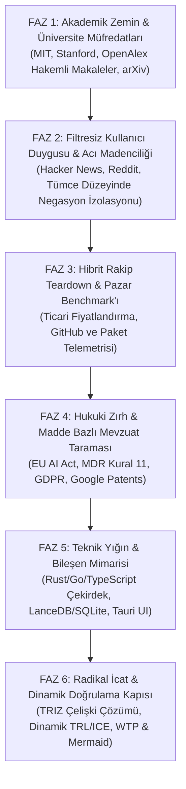

# Zobar Skill: Deep-Tech, Market & Radical Invention Engine

> **Aforizma:** *"Sıradanlık en büyük risktir. Bir sistem inşa edilecekse; bilimin en uç teorisiyle temellenmeli, sokaktaki kullanıcının en derin acısını çözmeli, hukuki olarak zırhlı olmalı, uygulanabilirliği ve ticari talebi kanıtlanmış radikal icatları bünyesinde barındırmalıdır."*

---

## 1. Temel Felsefe ve Çalışma İlkeleri

1. **Sıfır Vasatlık (Zero Mediocrity):** "Herkes böyle yapıyor" cevabı kesinlikle yasaktır. Standart şablonlar, modası geçmiş öneriler ve klişeler reddedilir.
2. **Bilgiyi Sömür, Hizmet Etme (Extract, Don't Serve):** Üniversitelere eğitim projesi yapılmaz; üniversitelerin (MIT, Stanford, Oxford, ETH Zürich vb.), dünyanın en seçkin profesörlerinin ve düşünürlerinin ürettiği saf bilgi süzülüp ürüne aktarılır.
3. **Filtresiz Kullanıcı Gerçeği (Unfiltered Truth):** Kullanıcıların cilalı anket cevaplarına değil; Reddit'te, mağaza şikayetlerinde, forumlarda haykırdıkları gerçek nefret ve hayal kırıklıklarına odaklanılır. Cümle ve tümce düzeyinde olumsuzlama (negation) ayrıştırması yapılır.
4. **Hukuki Zırh & FTO Bilinci (Legal Shield):** Kanunları ihlal etmek veya gri alanda tökezlemek yok; sistem baştan telif, IP, KVKK/GDPR ve regülasyonlara göre kurşun geçirmez tasarlanır. (Otomatik patent taramaları ve mevzuat analizleri teknik ön araştırma niteliğindedir; resmi FTO veya hukuki mütalaa yerine geçmez.)
5. **Dinamik Kanıtlanmış İcat Zorunluluğu (Dynamic Validated Invention):** Bu skill her çalıştığında, mevcut çözümlerde bulunmayan **en az 2 özgün icat/mekanizma** üretir; ANCAK bu icatlar hayal ürünü bilim-kurgu olarak kalamaz: Her icadın **TRL (Teknolojik Olgunluk), TRL İlerleme Şartı, ICE skoru, Hata Modları ve Ticari Talep (WTP - Ödeme İstekliliği)** dinamik formüllerle kanıtlanmak zorundadır.
6. **Görsel Zorunluluk (Visual Imperative):** Her analiz en az bir adet kapsamlı **Mermaid mimari veya kullanıcı akış şeması** içermelidir.

---

## 2. Altı Fazlı İcra Protokolü (The 6-Phase Protocol)

Bu yetenek tetiklendiğinde analizi aşağıdaki 6 fazı sırasıyla ve eksiksiz işleterek sunar:



---

### FAZ 1: Akademik Zemin, Üniversite Müfredatları & Hakemli Literatür
* **Kaynak Havuzu & Yardımcı Araçlar:**
  - Üniversite müfredatları (MIT, Stanford, ETH Zürich, Oxford), ders kitapları ve OpenAlex hakemli makaleler için:
    ```bash
    python ./scripts/fetch_university_research.py "<konu>" --max 3
    ```
  - Güncel arXiv pre-print ön baskı taraması için:
    ```bash
    python ./scripts/fetch_academic_papers.py "<konu>" --max 3
    ```
* **Görev:**
  - Bu alanın matematiksel, algoritmik ve bilimsel temelleri nelerdir?
  - MIT, Stanford, ETH ve Oxford'un lisansüstü derslerinde öğretilen temel zihinsel modeller ve seminal ders kitapları nelerdir?
  - Hakemli yayınların doğrulanmış atıf sayıları ve ön baskıların güncel teorik sınırları nelerdir?

### FAZ 2: Filtresiz Kullanıcı Duygusu & Acı Madenciliği (User Sentiment)
* **Kaynak Havuzu & Yardımcı Araç:**
  - Tümce seviyesinde ve olumsuzlama filtreli kullanıcı şikayet madenciliği için:
    ```bash
    python ./scripts/mine_user_sentiment.py "<ürün/konu>" --max 5
    ```
  - Hacker News tartışmaları ve Reddit toplulukları (`r/programming`, `r/sysadmin`, `r/technology` vb.).
* **Görev:**
  - İnsanlar bu konudaki mevcut araçlarda neye öfkeleniyor?
  - Olumsuzlama ifadeleriyle arındırılmış gerçek acı cümleleri ve sürtünme skoru (Friction Score).

### FAZ 3: Hibrit Rakip Teardown & Pazar Benchmark'ı (Competitor Moat)
* **Kaynak Havuzu & Yardımcı Araç:**
  - Hibrit rakip analizi için:
    ```bash
    python ./scripts/benchmark_competitors.py "<konu>" --max 3
    ```
* **Görev:**
  - Pazar liderlerinin güncel ticari fiyatlandırma modelleri ve yapısal kör noktaları.
  - Canlı GitHub açık kaynak projelerinin yıldız, fork, lisans ve commit telemetrisi.
  - Yayınlanmış npm/PyPI paket kayıtları.

### FAZ 4: Hukuki Zırh & Madde Bazlı Mevzuat Taraması (Legal Fortress)
* **Kaynak Havuzu & Yardımcı Araçlar:**
  - Ön patent taraması için:
    ```bash
    python ./scripts/search_prior_art.py "<teknoloji/icat konusu>" --max 5
    ```
  - Kullanım amacı odaklı EU AI Act, MDR ve GDPR uyumluluğu için:
    ```bash
    python ./scripts/scan_regulations.py "<konu/teknoloji>"
    ```
* **Görev:**
  - Kullanım amacına göre EU AI Act seviyesi (Yasaklı, Yüksek Risk, Şeffaflık, Ar-Ge Muafiyeti, Minimal Risk).
  - MDR (AB) 2017/745 Kural 11 klinik ayrımı ve GDPR Madde 6/9/22 yükümlülükleri.

### FAZ 5: Teknik Yığın, UI/UX Bileşen Mimarisi & 100+ S-Tier Tasarım Havuzu (Tech Blueprint)
* **Kaynak Havuzu & Yardımcı Araçlar:**
  - Teknik mimari ve bileşen sentezi için:
    ```bash
    python ./scripts/synthesize_architecture.py "<konu>"
    ```
  - 100+ S-Tier siteden (Netflix, Stripe, Linear, Apple vb.) tasarım deseni ve bileşen çekmek için:
    ```bash
    python ./scripts/recommend_ui_patterns.py "<konu>" --max 4
    ```
* **Görev:**
  - Gecikme ve bellek güvenliğine göre çekirdek dil (Rust, Go, TypeScript).
  - Sıfır konfigürasyonlu yerel veri katmanı (LanceDB, SQLite).
  - 100+ S-Tier siteden eşleşen canlı URL'ler, hero desenleri, renk tokenları ve mikro-etkileşimler.
  - Modern erişilebilir arayüz yığını (Tauri v2, React 19, Radix UI, Tailwind CSS v4).

### FAZ 6: Radikal İcat & Dinamik Doğrulama Kapısı (Feasibility Gate)
* **Kaynak Havuzu & Yardımcı Araç:**
  ```bash
  python ./scripts/validate_inventions.py "<konu>"
  ```
* **Zorunlu Doğrulama Kriterleri:**
  1. **TRL Olgunluk Seviyesi:** Alan kısıtlarına göre hesaplanmış TRL ve bir üst TRL'e geçiş için gerekli ampirik ilerleme şartı.
  2. **Dinamik ICE Skoru:** `Etki (1-10) x Güven (1-10) x Kolaylık (1-10) / 10`.
  3. **Ticari Talep & WTP:** Hedef kitle, fiyatlama aralığı ve alternatif maliyet.
  4. **Kritik Hata Modları:** Sistemin çökebileceği 3 ekstrem durum ve mimari önlemler.
  5. **Mermaid Mimari Şeması:** Sistemin veri akışını gösteren yürütülebilir şema.

---

## 3. Tek Komutla 6 Fazlı Otonom İcra

Tüm süreci uçtan uca otomatik olarak çalıştırmak ve Markdown + görsel HTML Dashboard raporu üretmek için:

```bash
python run_innovator.py "<hedef_konu>" --output dossier.md --html dashboard.html
```
