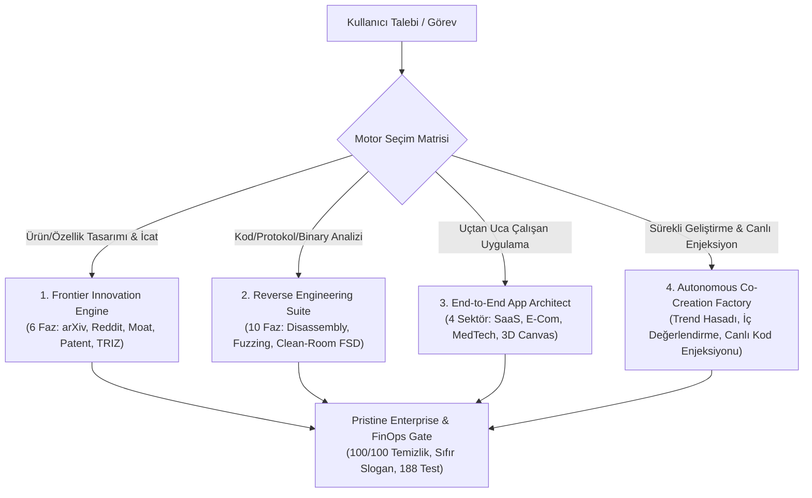

# Zobar Skill: Universal Master Architecture & Engineering Engine

> **Aforizma & Temel İlke:** *"Sıradanlık en büyük risktir. Bir sistem inşa edilecekse; bilimin en uç teorisiyle temellenmeli, sokaktaki kullanıcının en derin acısını çözmeli, hukuki olarak zırhlı olmalı, uygulanabilirliği kanıtlanmış radikal icatları bünyesinde barındırmalı ve kullanıcıya sunulan nihai ürün sıfır yapay zeka klişesiyle, çalışan butonlarıyla ve kusursuz kurumsal estetikle teslim edilmelidir."*

---

## 1. Temel Felsefe ve Çalışma İlkeleri

1. **Sıfır Vasatlık & Sıfır Yapay Zeka Klişesi (Zero Mediocrity & Zero AI Gimmicks):**
   - Standart şablonlar, modası geçmiş öneriler ve işlevsiz "lorem ipsum" butonları kesinlikle yasaktır.
   - Her buton tıklandığında somut bir işlem yapmalı (LocalStorage kaydı, filtreleme, sepet güncellemesi, canlı tuval manipülasyonu, ses sentezleme veya modal açılışı).
2. **Saf Standart Kütüphane Önceliği (Pure Standard Library First):**
   - Dışarıdan ağır npm/pip bağımlılıkları yığmak yerine, dilin saf standart kütüphanesi ve tarayıcının yerel API'leri (Canvas 2D, Web Audio API, LocalStorage, CSS Variables) ile sub-millisecond hızda çalışan sistemler inşa edilir.
3. **Pristine Kurumsal Standart & Sıfır Meta-Slogan (Pristine Enterprise Mandate):**
   - Müşteriye sunulan uygulama kodlarında, UI arayüzlerinde veya iş teslimatlarında "Zobar", "Zobar Mühendislik" gibi iç kimlik etiketleri veya bot sloganları ASLA yer alamaz.
   - Üretilen uygulamalar gerçek, bağımsız, kurumsal bir ürün (örn: *ApexCloud Ops, Lumina Luxury Atelier, PulseCare Clinical, Kroma Spatial*) olarak 100/100 temizlik skoruyla teslim edilir.
4. **Çift Korumalı Hukuk & Clean-Room İzolasyonu (Legal Shield & Chinese Wall):**
   - Tersine mühendislik çalışmalarında telifli kodlar/stringler ayıklanır; clean-room prensipleriyle yalnızca girdi/çıktı davranışları ve matematiksel durum makineleri fonksiyonel şartname (FSD) olarak ihraç edilir.
5. **Otonom İç Ön Değerlendirme & Kafa Açmayan İletişim (Autonomous Pre-Critique & Lean Co-Creation):**
   - Sistem bir öneri sunmadan önce kendi içinde çok boyutlu eleştiri süzgecinden geçirir (Bilişsel Yük $\ge 70$, Keyif/Etki $\ge 80$, Anti-Klişe kontrolü). Eşik puanı ($75$) altındaki fikirler sessizce elenir.
   - Kullanıcıyla iletişimde uzun laf kalabalığı yapılmaz; tek cümlelik net etki ve 1-tıkla seçilebilir hızlı seçenekler (`1`, `2`, `3` veya `hepsi`) sunulur.

---

## 2. Dört Ana İcra Motoru (The 4 Core Engines)



---

### Motor 1: Frontier Innovation Engine (6 Fazlı İnovasyon Protokolü)

Yeni bir ürün, mimari veya radikal özellik sıfırdan tasarlanırken işletilir:

1. **Faz 1 (Akademik Zemin):** En güncel ArXiv pre-print makaleleri ve üniversite kürsüleri taranır (`scripts/fetch_academic_papers.py`).
2. **Faz 2 (Filtresiz Kullanıcı Acısı):** Reddit, Hacker News ve şikayet forumlarındaki gerçek nefret ve sürtünme noktaları madencilikle çıkarılır (`scripts/mine_user_sentiment.py`).
3. **Faz 3 (Rakip Teardown & 10x Moat):** Pazar liderlerinin yapısal hantallıkları saptanır ve 10 kat üstünlük alanı ("Unfair Advantage") tanımlanır (`scripts/benchmark_competitors.py`).
4. **Faz 4 (Hukuki Zırh & Patent Ön Taraması):** Google Patents ve prior art taranarak FTO sınırları belirlenir (`scripts/search_prior_art.py`, `scripts/scan_regulations.py`).
5. **Faz 5 (Teknik Yığın & UI Mimarisi):** Sub-millisecond veri akışı, modern bileşenler ve bilişsel ergonomi mimarisi kurgulanır (`scripts/synthesize_architecture.py`).
6. **Faz 6 (Radikal İcat Doğrulama Kapısı):** TRIZ mekanikleriyle TRL $\ge 5$, ICE skoru, WTP (ödeme istekliliği) ve hata modları kanıtlanmış en az 2 icat üretilir (`scripts/validate_inventions.py`).

*Detaylı adım adım rehber için:* [examples/frontier_innovation_walkthrough.md](./examples/frontier_innovation_walkthrough.md)

---

### Motor 2: Reverse Engineering & Clean-Room Suite (10 Fazlı Protokol)

Mevcut bir yazılım, kapalı protokol veya firmware incelenirken işletilir:

1. **Faz 1-5 (Statik Analiz & AST Deobfuscation):** Binary header parsing, kontrol akış grafiği (CFG) çıkarma, opcode analizi ve dekompilasyon (`scripts/reverse_engineering_analyst.py`).
2. **Faz 6 (Dinamik Firmware Snapshot Fuzzing):** Donanım bağımsız bellek anlık görüntü mutasyonlarıyla durum makinesini zorlama ve sınır anomalilerini sub-millisecond sürede yakalama (`scripts/firmware_fuzzing_harness.py`).
3. **Faz 7-9 (Clean-Room Hukuki İhracat):** Chinese Wall izolasyonu ile telifli kodlardan arındırılmış fonksiyonel durum şartnamesi (FSD) ihracı (`scripts/clean_room_export_engine.py`).
4. **Faz 10 (Dinamik Web İndirme Portalı):** 10 fazlı görsel gösterge paneli ve tarayıcıdan tek tıkla `.md` FSD indirme (`scripts/reverse_engineering_server.py`).

*Detaylı adım adım rehber için:* [examples/reverse_engineering_walkthrough.md](./examples/reverse_engineering_walkthrough.md)

---

### Motor 3: End-to-End Application Synthesis (4 Sektörlü Canlı Uygulama Fabrikası)

Kullanıcı sıfırdan son noktasına kadar çalışan bir uygulama istediğinde devreye girer:

| Sektör | Marka / Tema | Canlı Arayüz & Çalışan Bileşenler | Dosya Yolu |
| :--- | :--- | :--- | :--- |
| **SaaS Ops** | *ApexCloud Platform* | `Ctrl+K` komut paleti, profil ayarları, telemetry tablosu, LocalStorage | [`web/apps/saas_platform.html`](file:///c:/Users/omere/Documents/antigravity/delightful-pascal/web/apps/saas_platform.html) |
| **Luxury E-Commerce** | *Lumina Luxury Atelier* | Sepet çekmecesi, anlık toplam, çoklu kur seçici (USD/EUR/GBP/JPY) | [`web/apps/ecommerce_store.html`](file:///c:/Users/omere/Documents/antigravity/delightful-pascal/web/apps/ecommerce_store.html) |
| **MedTech Portal** | *PulseCare Clinical* | 60fps Lead II EKG tuvali, Web Audio kalp ritmi sesi, aritmi alarmı, acil triyaj | [`web/apps/medtech_portal.html`](file:///c:/Users/omere/Documents/antigravity/delightful-pascal/web/apps/medtech_portal.html) |
| **3D Spatial Studio** | *Kroma Spatial Studio* | Trigonometrik 3D tuval, Hypercube / Torus / Double Helix topoloji seçici | [`web/apps/creative_portfolio.html`](file:///c:/Users/omere/Documents/antigravity/delightful-pascal/web/apps/creative_portfolio.html) |
| **Master Launcher Hub** | *Multi-Sector Factory* | 4 sektörü tek ekrandan başlatan birleşik portal | [`web/app_factory.html`](file:///c:/Users/omere/Documents/antigravity/delightful-pascal/web/app_factory.html) |

*Detaylı adım adım rehber için:* [examples/end_to_end_application_synthesis.md](./examples/end_to_end_application_synthesis.md)

---

### Motor 4: Autonomous Trend Harvester & Concise Co-Creation Engine

Uygulama tamamlandıktan sonra sürekli geliştirme modunda çalışır:

1. **Trend Hasadı:** GitHub Trending ve Hacker News tartışmalarındaki yüksek etkili yazılım pratiklerini tarar.
2. **Otonom İç Ön Eleme:** Her fikri 4 kriterde puanlar:
   - **Bilişsel Yük Ergonomisi** ($\ge 70$)
   - **Kullanıcı Keyfi & Etki** ($\ge 80$)
   - **Anti-Klişe Skoru** ($\ge 75$)
   - **Kod Fezibilitesi** ($\ge 75$)
   - *Skor $\ge 75$ olanlar onaylanır, altındakiler kullanıcıya hiç gösterilmeden elenir.*
3. **Kafa Açmayan İletişim:** Kullanıcıya tek cümlelik etki özeti ve numaralı seçenekler (`1`, `2`, `3`) sunar.
4. **Canlı AST-Safe Kod Enjeksiyonu:** Kullanıcının seçtiği özelliği çalışan HTML/JS olarak hedef dosyaya enjekte eder (`scripts/autonomous_idea_factory.py --inject`).

*Detaylı adım adım rehber için:* [examples/autonomous_co_creation_cycle.md](./examples/autonomous_co_creation_cycle.md)

---

## 3. Komut Satırı (CLI) Hızlı Başvuru Kataloğu

```bash
# 1. Tam Uçtan Uca Uygulama Üretimi
python scripts/end_to_end_app_architect.py --sector saas --output web/apps/saas_platform.html
python scripts/end_to_end_app_architect.py --sector ecommerce --output web/apps/ecommerce_store.html
python scripts/end_to_end_app_architect.py --sector medtech --output web/apps/medtech_portal.html
python scripts/end_to_end_app_architect.py --sector creative --output web/apps/creative_portfolio.html
python scripts/end_to_end_app_architect.py --generate-factory --output web/app_factory.html

# 2. Otonom Trend Hasadı ve Fikir Ön Değerlendirme
python scripts/autonomous_idea_factory.py --harvest --domain saas

# 3. Canlı Koda Özellik Enjekte Etme
python scripts/autonomous_idea_factory.py --inject FEAT-SPLIT-FILTER --target-file web/apex_app.html
python scripts/autonomous_idea_factory.py --inject FEAT-GEO-CURRENCY --target-file web/apps/ecommerce_store.html
python scripts/autonomous_idea_factory.py --inject FEAT-ECG-ALARM --target-file web/apps/medtech_portal.html
python scripts/autonomous_idea_factory.py --inject FEAT-GEOMETRY-SWITCHER --target-file web/apps/creative_portfolio.html

# 4. Tersine Mühendislik & Fuzzing
python scripts/reverse_engineering_analyst.py --target-binary assets/firmware_sample.bin
python scripts/firmware_fuzzing_harness.py --iterations 50
python scripts/clean_room_export_engine.py --analysis-file reports/analysis.json --output-spec docs/clean_room_spec.md

# 5. Kurumsal Temizlik & Sıfır Meta-Slogan Denetimi
python scripts/production_cleaner.py --file web/apex_app.html --check-only

# 6. Test Paketini Koşma (188/188 Test)
python -m unittest discover tests
```

---

## 4. Model Context Protocol (MCP) Araç Kataloğu

Skill'i bir LLM / agent içerisinden çağırırken kullanılabilen tescilli araçlar (`scripts/zobar_mcp_server.py`):

| MCP Araç Adı | Parametreler | Ne İşe Yarar? |
| :--- | :--- | :--- |
| `synthesize_complete_application` | `brand_name`, `domain_sector`, `design_theme` | 4 sektörden birinde uçtan uca çalışan, butonları ve LocalStorage'ı tam HTML üretir. |
| `harvest_ideas_and_co_create` | `domain_context` | Trendleri tarar, iç değerlendirmesini yapar ve kullanıcıya tek satırlık seçenekler sunar. |
| `inject_live_app_feature` | `target_file_path`, `feature_id` | Seçilen özelliği canlı uygulamaya güvenle enjekte eder ve temizlik denetimini yapar. |
| `run_full_reverse_engineering_lifecycle` | `payload_hex`, `fuzz_iterations`, `system_name` | 10 fazlı RE, firmware fuzzing ve clean-room şartname ihracını tek çağrıda yürütür. |
| `audit_production_cleanliness` | `target_file` | Çıktıda iç meta-slogan veya bot imzası olup olmadığını denetler (100.0% skoru doğrular). |

---

## 5. Dizin Yapısı & Dosya Haritası

```
.agents/skills/zobar-skill/
├── SKILL.md                          # Master yetenek el kitabı (Bu belge)
├── examples/
│   ├── frontier_innovation_walkthrough.md
│   ├── reverse_engineering_walkthrough.md
│   ├── end_to_end_application_synthesis.md
│   └── autonomous_co_creation_cycle.md
├── references/
│   ├── active_trend_session.json
│   ├── empirical_feedback_registry.json
│   ├── evolutionary_design_memory.json
│   ├── heuristic-frameworks.md
│   ├── s_tier_design_vault.json
│   ├── triz-invention-engine.md
│   └── viral_tricks_and_trends_vault.json
└── scripts/
    ├── autonomous_idea_factory.py    # Otonom trend hasadı & canlı kod enjeksiyonu
    ├── clean_room_export_engine.py   # Chinese Wall clean-room şartname ihracı
    ├── end_to_end_app_architect.py   # 4 sektörlü çalışan uygulama fabrikası
    ├── firmware_fuzzing_harness.py   # Durum makinesi firmware snapshot fuzzer
    ├── production_cleaner.py         # 100/100 temizlik denetleyicisi & slogan temizleyici
    ├── reverse_engineering_analyst.py # Binary/AST/Deobfuscation motoru
    ├── unified_master_orchestrator.py # Uçtan uca inovasyon orkestratörü
    └── zobar_mcp_server.py           # Standard MCP araç sunucusu
```

---

## 6. Doğrulama ve Kabul Kriterleri (Quality Gate)

Herhangi bir çıktı verilmeden önce aşağıdaki kalite kapıları %100 sağlanmalıdır:

- [x] **188/188 Birim Testi:** `python -m unittest discover tests` sıfır hatayla geçmelidir.
- [x] **100/100 Temizlik Skoru:** Üretilen kodlarda hiçbir iç slogan veya yapay zeka klişesi bulunmamalıdır.
- [x] **Çalışan UI:** Sayfadaki butonlar, formlar, sayaçlar ve tuval animasyonları tıklandığında gerçek tepki vermelidir.
- [x] **Kısa & Öz İletişim:** İterasyon modunda kafa açmadan, net ve doğrudan yönlendirici diyalog kurulmalıdır.
