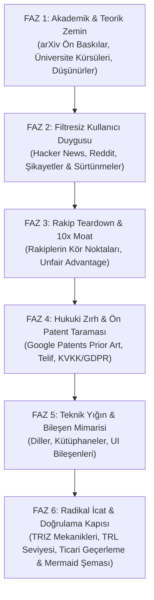

# Zobar Skill: Deep-Tech, Market & Radical Invention Engine

> **Aforizma:** *"Sıradanlık en büyük risktir. Bir sistem inşa edilecekse; bilimin en uç teorisiyle temellenmeli, sokaktaki kullanıcının en derin acısını çözmeli, hukuki olarak zırhlı olmalı, uygulanabilirliği ve ticari talebi kanıtlanmış radikal icatları bünyesinde barındırmalıdır."*

---

## 1. Temel Felsefe ve Çalışma İlkeleri

1. **Sıfır Vasatlık (Zero Mediocrity):** "Herkes böyle yapıyor" cevabı kesinlikle yasaktır. Standart şablonlar, modası geçmiş öneriler ve klişeler reddedilir.
2. **Bilgiyi Sömür, Hizmet Etme (Extract, Don't Serve):** Üniversitelere eğitim projesi yapılmaz; üniversitelerin (MIT, Stanford, Oxford, ETH Zürich vb.), dünyanın en seçkin profesörlerinin ve düşünürlerinin ürettiği saf bilgi süzülüp ürüne aktarılır.
3. **Filtresiz Kullanıcı Gerçeği (Unfiltered Truth):** Kullanıcıların cilalı anket cevaplarına değil; Reddit'te, mağaza şikayetlerinde, forumlarda haykırdıkları gerçek nefret ve hayal kırıklıklarına odaklanılır.
4. **Hukuki Zırh & FTO Bilinci (Legal Shield):** Kanunları ihlal etmek veya gri alanda tökezlemek yok; sistem baştan telif, IP, KVKK/GDPR ve regülasyonlara göre kurşun geçirmez tasarlanır. (Otomatik patent taramaları ön araştırma niteliğindedir; resmi FTO görüşü yerine geçmez.)
5. **Kanıtlanmış İcat Zorunluluğu (Validated Invention):** Bu skill her çalıştığında, mevcut çözümlerde bulunmayan **en az 2-3 özgün icat/mekanizma** üretir; ANCAK bu icatlar hayal ürünü bilim-kurgu olarak kalamaz: Her icadın **TRL (Teknolojik Olgunluk), ICE skoru, Hata Modları ve Ticari Talep (WTP - Ödeme İstekliliği)** kanıtlanmak zorundadır.
6. **Görsel Zorunluluk (Visual Imperative):** Her analiz en az bir adet kapsamlı **Mermaid mimari veya kullanıcı akış şeması** içermelidir.

---

## 2. Altı Fazlı İcra Protokolü (The 6-Phase Protocol)

Bu yetenek tetiklendiğinde analizi aşağıdaki 6 fazı sırasıyla ve eksiksiz işleterek sunar:



---

### FAZ 1: Akademik & Teorik Zemin (Academic Ground Truth)
* **Kaynak Havuzu & Yardımcı Araç:**
  - Canlı makale taraması için `./scripts/fetch_academic_papers.py` betiğini çalıştır:
    ```bash
    python ./scripts/fetch_academic_papers.py "<konu>" --max 5
    ```
  - Dünyanın önde gelen üniversite kürsüleri (bilgisayar bilimleri, HCI, davranışsal ekonomi, dağıtık sistemler), seminal ders kitapları ve vizyoner akademisyenler/düşünürler (Donald Knuth, Yann LeCun, Andrew Ng, Clayton Christensen, Leslie Lamport).
* **Görev:**
  - Bu alanın matematiksel, algoritmik ve bilimsel temelleri nelerdir?
  - En güncel ArXiv pre-print makaleleri ve üniversite müfredatları bu problem hakkında ne diyor? *(arXiv ön baskılarının henüz hakem denetiminden geçmemiş olabileceği göz önünde bulundurulmalı ve kanıt düzeyi belirtilmelidir).*
  - Bilimin belirlediği teorik sınırlar ve fırsatlar nelerdir?

### FAZ 2: Filtresiz Kullanıcı Duygusu & Gizli Talepler (User Sentiment)
* **Kaynak Havuzu & Yardımcı Araç:**
  - Çok kaynaklı kullanıcı eleştirisi madenciliği için `./scripts/mine_user_sentiment.py` betiğini çalıştır:
    ```bash
    python ./scripts/mine_user_sentiment.py "<ürün/konu>" --max 5
    ```
  - Hacker News tartışmaları, Reddit (`r/technology`, `r/sysadmin`, `r/programming` vb.), uygulama mağazaları 1-2 yıldızlı şikayetleri.
* **Görev:**
  - İnsanlar bu konudaki mevcut araçlarda neye öfkeleniyor?
  - En çok hangi hatalar, yavaşlıklar veya karmaşık adımlar insanları bezdiriyor? (Sürtünme Skoru).
  - Kullanıcıların açıkça dile getiremediği ama davranışlarından anlaşılan "gizli arzuları" neler?

### FAZ 3: Rakip Teardown & 10x Rekabet Üstünlüğü (Competitor Moat)
* **Görev:**
  - Mevcut pazar liderleri ve güçlü oyuncular tek tek masaya yatırılır.
  - Güçlü yönleri ve özellikle **yapısal kör noktaları (hantallıkları, legacy kodları, ticari kısıtları)** tespit edilir.
  - *"Biz hangi alanda (hız, sadelik, zeka, ergonomi, maliyet) rakiplerden 10 kat daha iyi olacağız?"* sorusunun cevabı ("Unfair Advantage") tanımlanır.

### FAZ 4: Hukuki Çerçeve & Ön Patent Taraması (Legal Fortress)
* **Kaynak Havuzu & Yardımcı Araç:**
  - Öncelikli teknik ve patent tescili taraması için `./scripts/search_prior_art.py` betiğini çalıştır:
    ```bash
    python ./scripts/search_prior_art.py "<teknoloji/icat konusu>" --max 5
    ```
* **Görev:**
  - Fikri Mülkiyet (IP), patent ihlali riskleri ve açık kaynak lisans uyumlulukları (MIT, Apache 2.0, GPL sınırları).
  - Veri koruma yasaları (KVKK, GDPR, CCPA) ve yapay zeka regülasyonları (EU AI Act vb.).
  - Sistemin yasal olarak sıfır riskle ölçeklenmesini sağlayacak mimari önlemler belirlenir. *(Ön tarama nihai hukuki FTO görüşü yerine geçmez).*

### FAZ 5: Teknik Yığın & UI/UX Bileşen Mimarisi (Tech & Design Blueprint)
* **Kodlama Dilleri & Altyapı:**
  - Sadece trend olduğu için değil; hız, bellek verimliliği, concurrency ve sürdürülebilirlik kriterlerine göre dil ve framework seçimi (Rust, Go, TypeScript, Python vb.).
  - Veri mimarisi, cache katmanları, API protokolleri (gRPC, WebSocket, tRPC).
* **Tasarım & UI/UX Bileşenleri:**
  - Kullanılacak modern bileşen kütüphaneleri (shadcn/ui, Radix, Tailwind, Canvas/WebGL mikro-etkileşimleri).
  - Kullanıcı ergonomisi: Bilişsel yükü sıfıra indiren arayüz felsefesi.

### FAZ 6: Radikal İcat & Doğrulama Kapısı (Breakthrough & Feasibility Gate)
* **İcat Kılavuzu:** İcat üretirken [triz-invention-engine.md](./references/triz-invention-engine.md) prensiplerini (özellikle Tersine Çevirme, Önceden Eylem ve Kendi Kendine İyileşme) temel al. Vizyon asla sıradanlaşmamalı, ancak havada asılı bilim-kurgu vaatler yerine ayakları yere basan bir ispat disiplinine dayanmalıdır.
* **Zorunlu Doğrulama Kapısı (Validation Gate):**
  Her üretilen icat için aşağıdaki 4 kriterin doldurulması **ZORUNLUDUR**:
  1. **TRL Olgunluk Seviyesi (1-9):** Model Tahmini mi yoksa Literatür/Prototip Kanıtı mı? (Örn: TRL 3: Matematiksel/Algoritmik ispat var, TRL 5: Sandbox ortamında test edildi).
  2. **ICE Skoru:** `Etki (1-10) x Güven (1-10) x Kolaylık (1-10) / 10`.
  3. **Ticari Talep & WTP (Ödeme İstekliliği):** Müşteri bu özelliğe neden para öder? Alternatif maliyeti nedir? (Doğrulanmış pazar kanıtı mı, model hipotezi mi?).
  4. **Kritik Hata Modları (Failure Modes):** Bu icat hangi 3 ekstrem koşulda çöker veya kullanılamaz hale gelir; bunu engelleyen mimari önlem nedir?
* **Görselleştirme:** Sistemin veya icadın çalışma dinamiğini gösteren detaylı bir **Mermaid mimari/akış diyagramı** üret.

---

## 3. Standart Çıktı Rapor Formatı

Her analiz yapıldığında aşağıdaki şablon takip edilmelidir:

```markdown
# [PROJE/KONU ADI] — Uç Nokta İnovasyon & Mimari Raporu

## 📌 Yönetici Özeti & Çekirdek Tez
(Problemin özü, çözümsüzlük paradoksu ve bizim radikal çözümümüz.)

---

## 🏛️ 1. Akademik & Teorik Zemin
- **Teorik Temel:** ...
- **arXiv Pre-print ve Literatür Bulguları (Kanıt Düzeyiyle):** ...
- **Büyük Düşünürlerin / Profesörlerin Perspektifi:** ...

---

## 💬 2. Filtresiz Kullanıcı Duygusu & Pazarın Çığlığı
- **Hacker News & Reddit Şikayetleri:** ...
- **En Büyük Sürtünmeler & Nefret Sebepleri:** ...
- **Karşılanmamış Gizli Talepler:** ...

---

## ⚔️ 3. Rakip Teardown & 10x Moat
| Rakip | Zayıf Karın (Kör Nokta) | Bizim 10x Karşı Hamlemiz |
| :--- | :--- | :--- |
| Rakip A | ... | ... |
| Rakip B | ... | ... |

---

## ⚖️ 4. Hukuki Zırh & Ön Patent Taraması
- **Fikri Mülkiyet & Google Patents Ön İnceleme Bulguları:** ...
- **KVKK / GDPR / Veri Egemenliği Kontrol Listesi:** ...
- **Yasal Feragat:** (Otomatik tarama ön incelemedir, FTO yerine geçmez)

---

## 🛠️ 5. Teknik Mimari & UI/UX Bileşenleri
- **Dil ve Teknoloji Yığını:** (Seçim gerekçeleriyle)
- **UI/UX Bileşenleri & Etkileşimler:** (Component bazında döküm)

---

## 🚀 6. Radikal İcatlar & Fizibilite Doğrulama Kapısı

### İcat #1: [İsim]
- **Çalışma Prensibi & Sisteme Entegrasyonu:** ...
- **TRL Olgunluk Seviyesi:** TRL ...
- **ICE Skoru:** Etki: .../10 | Güven: .../10 | Kolaylık: .../10
- **Ticari Talep & WTP:** (Müşteri neden para öder?)
- **Kritik Hata Modları:** (Hangi 3 durumda çöker?)

### Sistem & İnovasyon Mimarisi (Mermaid)
```mermaid
...
\```
```
