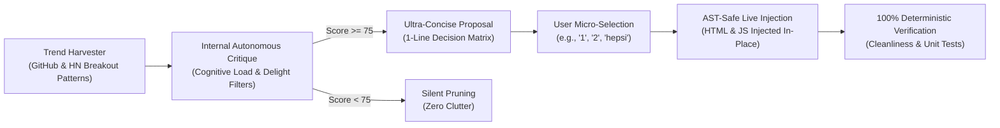

# Example 4: Autonomous Co-Creation & Live Feature Injection Walkthrough

This walkthrough demonstrates the continuous co-creation loop: harvesting breakout software trends, vetting them through an internal multi-dimensional critique filter ($\ge 75$ threshold), presenting ultra-concise 1-line proposals to avoid cognitive fatigue, and injecting working code directly into live applications.

---

## 1. The Autonomous Co-Creation Loop



---

## 2. CLI Execution

### Step 1: Harvest and Pre-Evaluate Trend Ideas
```bash
python scripts/autonomous_idea_factory.py --harvest --domain saas
```
* **Output:**
  - Evaluates candidate features against 4 criteria: Utility Impact, Cognitive Ergonomics, Anti-Cliché Score, and Code Feasibility.
  - Generates crisp 1-line options:
    - `[1]` Inline Split-View Telemetry Filter (`FEAT-SPLIT-FILTER` | Score: 89)
    - `[2]` Optimistic Offline Mutation Queue (`FEAT-OFFLINE-QUEUE` | Score: 92)
    - `[3]` Dynamic Theme Accent Tuner (`FEAT-DARK-ACCENT-TOGGLE` | Score: 86)

### Step 2: Inject Selected Feature Live into Target App
```bash
python scripts/autonomous_idea_factory.py --inject FEAT-SPLIT-FILTER --target-file web/apex_app.html
```
* **Output:**
  - Injects idempotent HTML snippet before the primary data table.
  - Injects JS handler functions before `</script>`.
  - Runs automatic cleanliness audit ensuring 100/100 score.

---

## 3. Python API Integration

```python
from scripts.autonomous_idea_factory import harvest_and_curate_ideas, inject_feature_into_file

# 1. Harvest & critique ideas
curation = harvest_and_curate_ideas(domain_context="saas")
print("Total Approved:", curation["total_approved"])
for opt in curation["co_creation_dialogue"]["quick_options"]:
    print(f"[{opt['key']}] {opt['text']} (Score: {opt['score']})")

# 2. Inject feature into target file
result = inject_feature_into_file(
    target_file_path="web/apex_app.html",
    feature_id="FEAT-OFFLINE-QUEUE"
)
print("Injection Status:", result["status"])
print("Feature Title:", result["feature_title"])
```
