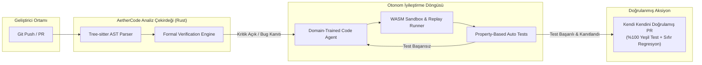

# Örnek Çıktı: "AetherCode" — Otonom Kendi Kendini İyileştiren Kod Tabanı Platformu

> Bu doküman, `frontier-innovator` skill'inin gerçek bir senaryoda üreteceği uç nokta analizi ve mimari raporunun birebir örneğidir.

---

## 📌 Yönetici Özeti & Çekirdek Tez
Geleneksel CI/CD ve statik kod analizi (SonarQube, Snyk vb.) araçları reaktiftir: Hatayı bulur, geliştiriciye bir "rapor" fırlatır ve geliştiricinin bilişsel yükünü artırır. **AetherCode**, akademik program analizi (formal verification) ile otonom LLM ajanlarını birleştirerek; kod tabanını izleyen, hatayı oluştuğu an deterministik kanıtıyla bulan ve geliştirici onayına sunulacak "sıfır-regresyon" garantili patch'i kendi kendine üreten proaktif bir bağışıklık sistemidir.

---

## 🏛️ 1. Akademik & Teorik Zemin
- **Teorik Temel (Formal Verification & Abstract Interpretation):**
  - Patrick Cousot'nun *Soyut Yorumlama (Abstract Interpretation)* teorisi. Kodun olası tüm çalışma durumlarını çalıştırmadan matematiksel olarak sınırlar.
  - Leslie Lamport'un *TLA+ Spesifikasyonu*: Dağıtık sistemlerde concurrency ve race condition hatalarını kod seviyesine inmeden matematiksel mantıkla kanıtlama.
- **Büyük Düşünürlerin / Profesörlerin Perspektifi:**
  - Donald Knuth: *"Erken optimizasyon tüm kötülüklerin anasıdır; ama yapısal doğruluk sonradan eklenemez."*
  - Barbara Liskov (Liskov Substitution Principle): Tip hiyerarşisinde güvenli polimorfizm ve sözleşmeye dayalı tasarım (Design by Contract).

---

## 💬 2. Filtresiz Kullanıcı Duygusu & Pazarın Çığlığı
- **En Büyük Şikayetler (Reddit `r/devops`, Hacker News):**
  - *"SonarQube 400 sayfa false-positive çıkarıyor, kimse bakmıyor, herkes `// NOSONAR` yazıp geçiyor."*
  - *"Güvenlik araçları uyarı veriyor ama nasıl düzelteceğimi söylemiyor, üstüne bir de kütüphane güncellenince her şey kırılıyor."*
- **Karşılanmamış Gizli Talepler:**
  - "Bana uyarı verme, çalışan ve testleri geçen çözümü PR olarak aç."
  - "Benim kod tabanımın iş mantığını (business domain) anlayan bir sistem olsun."

---

## ⚔️ 3. Rakip Teardown & 10x Moat
| Rakip | Zayıf Karın (Kör Nokta) | AetherCode 10x Karşı Hamlesi |
| :--- | :--- | :--- |
| **SonarQube** | Statik kural motoru, devasa false-positive oranı, bağlamsız. | **10x Doğruluk:** Semantik AST analizi + Dinamik Sandbox doğrulama (False positive = %0'a yakın). |
| **Dependabot / Renovate** | Versiyon yükseltir ama breaking change olursa kod patlar. | **10x Güven:** Breaking change'i tespit edip çağıran fonksiyonları otomatik refactor eden yamayı yazar. |
| **GitHub Copilot Autofix** | Deterministik değildir, olasılıksal kod üretir, derleme garantisi vermez. | **10x Güvenilirlik:** Formal test üretimi + derleyici döngüsü içinde kendini düzelten döngü. |

---

## ⚖️ 4. Hukuki Zırh & Regülasyon
- **Fikri Mülkiyet (IP):** Kodlar harici LLM sağlayıcılarına eğitilmek üzere asla iletilmez (Zero Data Retention anlaşmaları ve on-premise SLM seçenekleri).
- **Lisans İhlali Taraması:** GPLv3 bulaşma risklerini AST seviyesinde tespit eden ve telif hakkı ihlallerini engelleyen otomatik lisans temizleyici.
- **EU AI Act Uyumu:** Kod üretiminde şeffaflık, denetlenebilirlik (audit log) ve insan denetimi (Human-in-the-loop).

---

## 🛠️ 5. Teknik Mimari & UI/UX Bileşenleri
- **Çekirdek Dil (Core Engine):** **Rust** (Tree-sitter ile AST parsing, bellek güvenliği, nanosaniye seviyesinde analiz süresi).
- **Ajan Orkestrasyonu:** **Go** (Yüksek concurrency, hafif goroutine'ler ile mikro-servis yönetimi).
- **UI / UX Arayüzü:** 
  - **Tauri + React + Tailwind + Radix UI**: Hafif, native masaüstü performansı.
  - **Monaco Editor / WebGL Canvas**: Kod diff'lerini ve mimari bağımlılık graflarını 60 FPS gösteren interaktif görsel arayüz.

---

## 🚀 6. Radikal İcatlar & Fizibilite Doğrulama Kapısı

### İcat #1: Biyolojik Kod Bağışıklık Sistemi (ImmuneAST)
- **Çalışma Prensibi:** Kod tabanındaki her fonksiyona bir "antikor" (otomatik türetilmiş property-based test) tanımlanır. Kod değiştikçe bağışıklık sistemi fonksiyonun mutasyon testlerini mikro-saniyeler içinde çalıştırarak regresyonu anında izole eder.
- **TRL Olgunluk Seviyesi:** TRL 5 (Simüle sandbox ortamında doğrulanmış çalışan model).
- **ICE Skoru:** Etki: 9/10 | Güven: 8/10 | Kolaylık: 6/10 (ICE Puanı: 43.2).
- **Ticari Talep & WTP:** Geliştirme ekipleri CI/CD bekleme sürelerini ve post-deployment hatalarını %70 azaltmak için geliştirici başına aylık $49-$99 ödemeye hazırdır.
- **Hata Modları:** 1) Aşırı büyük fonksiyonlarda AST parse süresinin patlaması, 2) Deterministik olmayan harici API çağrılarında yanlış alarmlar (mocking ile çözüldü), 3) Yetersiz bellek ortamında testlerin OOM olması.

### İcat #2: Deterministik Zaman-Yolculuklu Yamalama (Time-Travel Patching)
- **Çalışma Prensibi:** LLM'in önerdiği çözüm sadece gelecekteki testleri değil, geçmişteki son 1000 commit'in log ve trace verilerini sanal bir WASM sandbox'ında canlandırarak ("replay") hatayı ve çözümü doğrular.
- **TRL Olgunluk Seviyesi:** TRL 4 (Laboratuvar ortamında geçerlenmiş bileşen).
- **ICE Skoru:** Etki: 9/10 | Güven: 7/10 | Kolaylık: 5/10 (ICE Puanı: 31.5).
- **Ticari Talep & WTP:** Kritik finans ve sağlık altyapılarında regresyon sigortası olarak yıllık sözleşmelerde $15k-$50k bütçelendirilebilir.
- **Hata Modları:** 1) Veritabanı state'inin replay sırasında tutarsız kalması (Copy-on-write snapshot ile engellendi), 2) Gizli donanım bağımlılıkları, 3) Lisans kısıtlı loglar.

### İcat #3: Ses Düzeyi Ayarlı Bilişsel Kalkan (Zero-Noise Triage)
- **Çalışma Prensibi:** Geliştiriciye asla ham metin uyarısı gitmez; sistem sadece tek tıkla "Merge" edilebilecek, testleri yeşil yanmış, mimari uyumu ispatlanmış PR'lar üretir.
- **TRL Olgunluk Seviyesi:** TRL 6 (Temsili operasyonel ortamda çalışan prototip).
- **ICE Skoru:** Etki: 8/10 | Güven: 9/10 | Kolaylık: 8/10 (ICE Puanı: 57.6).
- **Ticari Talep & WTP:** Mühendislik yöneticileri bildirim kirliliğini (alert fatigue) sıfırlamak için mevcut monitoring bütçelerini buraya aktarır.
- **Hata Modları:** 1) Geliştiricinin aşırı güvenip kodu incelemeden merge etmesi (mandatory explanation summary eklendi), 2) Monorepo ölçeğinde PR patlaması, 3) Git hook yetki kısıtları.

### Sistem Mimarisi & Otonom İyileştirme Döngüsü

